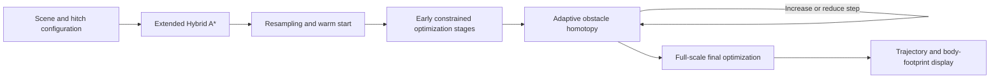

# Tractor–Trailer Planning with Progressively Constrained Optimal Control

[Download ZIP](https://github.com/libai1943/TractorTrailerTrajectoryPlanningWithPCOC/archive/refs/heads/master.zip) · [Getting started](#setup-and-one-command-run) · [Guide](#functions-and-model-files) · [Citation](#citation)

**Plan precise maneuvers for a tractor and three trailers in narrow environments.** This repository contains the MATLAB/AMPL implementation of **“Tractor-Trailer Vehicle Trajectory Planning in Narrow Environments With a Progressively Constrained Optimal Control Approach,”** published in *IEEE Transactions on Intelligent Vehicles*, 2020.

The method supports on-axle and off-axle hitching. An extended Hybrid A* search generates an initial route, and a sequence of optimal-control subproblems introduces difficult constraints progressively. During collision refinement, an adaptive homotopy expands scaled obstacles toward their full size and reuses the previous solution as the next warm start.

## Architecture



The state includes the tractor's planar position and the headings of the tractor and three trailers. Consequently, collision checking must account for all bodies, not just the tractor's reference point. The paper explains the kinematic model, extended search and progressively constrained optimal-control (PCOC) formulation.

## Setup and one-command run

Use **MATLAB on Windows**, an AMPL/IPOPT installation with a valid license, and the supplied protected helpers. The source calls the legacy **`robotics.ReedsSheppConnection`** API for Reeds–Shepp connections. Your MATLAB/toolbox installation must provide that API; inspect the two `GenerateRsPath...` functions when adapting to a newer navigation-toolbox API.

The original entry script explicitly identifies the bundled AMPL executable as a **trial version** and asks users to replace it with their own valid installation after trying it. Solver support libraries must match the selected executable. No MATLAB–AMPL API bridge is required.

```matlab
cd('C:/path/to/TractorTrailerTrajectoryPlanningWithPCOC');
RunMe;
```

Select the experiment using `test_case_number` near the top of `RunMe.m`:

| Setting | Obstacle scene | Hitch arrangement |
| --- | --- | --- |
| `1.1`, `2.1`, `3.1` | Scene 1, 2 or 3 | On-axle |
| `1.2`, `2.2`, `3.2` | Scene 1, 2 or 3 | Off-axle |

The default is **`3.2`**. Keep the model, run scripts and output folders in their original locations. Run from a writable checkout because MATLAB and AMPL repeatedly exchange files. At completion, the entry script calls `dsa.p` to display the result; it stops with an error if the checked intermediate optimization stages fail.

### Compare hitch geometries on one map

Run `3.1` first, save the displayed trajectory and the solver outputs you need, then repeat with `3.2` in a separate working copy. The integer part selects the same obstacle scene in both runs. The last digit changes the hitch geometry. Compare the swept **trailer footprints** at the tightest turn as well as the tractor path.

| Point in [the driver](RunMe.m) | What it tells you |
|---|---|
| After `PlanHybridAStarPath` and `ResampleConfig` | The search has produced an initial path for the optimizer. |
| After `r2.run` | `GetOptimizationStatus()` gates entry into obstacle restoration. |
| Inside the `r3.run` loop | `gamma_trial` is the scale attempted this cycle. Only a successful solve advances `gamma_achieved`. |
| After `r4.run` | The driver invokes `dsa` to display the final result. |

## Functions and model files

| File or group | Purpose |
| --- | --- |
| `RunMe.m` | Case selection, staged solves, homotopy loop and final display. |
| `InitParams.m` | Body geometry, kinematic limits, boundary conditions and search settings. |
| `GenerateObstacles.m`, `CreateCostmap.m` | Obstacle geometry and search cost map. |
| `PlanHybridAStarPath.m` | Main articulated-vehicle Hybrid A* search. |
| `CalculateH.m`, `CalculateH_2D.m`, `GenerateAStarPath.m` | Heuristic and grid-search support. |
| `GenerateRsPathForH.m`, `GenerateRsPathForSearch.m` | Reeds–Shepp connections for heuristic/search use. |
| `SimulateForward.m`, `Fulfill6DimFrom3Dim.m`, `ExpandFrom6DimToXY.m` | Propagate motion and recover articulated configurations/body positions. |
| `Is6DNodeValid.m`, `IsTractorStateValid.m`, `IsTrailerStateValid.m` | Search-state validity checks for tractor and trailers. |
| `Convert2DConfigToIndex.m`, `Convert6DimConfigToIndex.m`, `FindOpenlistIndex.m` | Search indexing and node lookup. |
| `ResampleConfig.m`, `ResampleConfigSimple.m` | Profile resampling. |
| `WriteFilesForNLPSetting.m`, `WriteInitialGuessForNLP.m`, `WriteWaypointsForStage1.m` | Write solver parameters, warm start and reference waypoints. |
| `EstimateGamma0.m`, `GenerateObstacleVertexes.m` | Initial homotopy scale and scaled obstacle data. |
| `GetOptimizationStatus.m` | Read the solve-status flag. |
| `ConvertVariablesToPolygons.m`, `CalculatePolygonArea.m` | Vehicle and polygon geometry. |
| `GenerateFigure.m`, `DrawRectangle.m`, `asd.p`, `dsa.p` | Result-drawing helpers. |
| `M0.mod`, `M1.mod`, `M1_5.mod`, `M2.mod`, `M3.mod`, `M4.mod` | Staged AMPL optimization formulations. |
| `r0.run`, `r1.run`, `r15.run`, `r2.run`, `r3.run`, `r4.run` | Corresponding model execution and file exchange. |

Keep the additional `.p` geometry, validity and visualization helpers with the project. The listed `.m` files expose the search and orchestration; P-code components are distributed in executable form.

## Adaptive homotopy in the driver

After the early optimization stages, `EstimateGamma0` chooses a starting obstacle scale. The loop calls `r3.run` at a trial scale and advances only when the optimization succeeds. The initial step is `0.05`; a failure multiplies it by `0.8`. Twenty consecutive successful cycles permit a larger step. The loop stops with an error if the step falls to `1e-5` or below, and otherwise continues until the scale reaches one. `r4.run` performs the final optimization.

This continuation strategy spreads collision-avoidance difficulty over several warm-started solves. It is the defining part of PCOC, rather than a single unconstrained smoothing operation.

## Citation

Please cite the source paper when using the code or method:

> Bai Li, Tankut Acarman, Youmin Zhang, Liangliang Zhang, Cagdas Yaman, and Qi Kong, “Tractor-Trailer Vehicle Trajectory Planning in Narrow Environments With a Progressively Constrained Optimal Control Approach,” *IEEE Transactions on Intelligent Vehicles*, **5**(3), 414–425, 2020. [DOI](https://doi.org/10.1109/TIV.2019.2960943).

```bibtex
@article{Li2020PCOC,
  author = {Li, Bai and Acarman, Tankut and Zhang, Youmin and
            Zhang, Liangliang and Yaman, Cagdas and Kong, Qi},
  title = {Tractor-Trailer Vehicle Trajectory Planning in Narrow Environments
           With a Progressively Constrained Optimal Control Approach},
  journal = {IEEE Transactions on Intelligent Vehicles},
  volume = {5}, number = {3}, pages = {414--425}, year = {2020},
  doi = {10.1109/TIV.2019.2960943}
}
```

The paper appeared online in December 2019 and in the September **2020** journal issue; the issue citation above uses the final publication year.

## License

See [GNU GPL v3](LICENSE). AMPL, IPOPT and other bundled third-party components retain their own licensing terms.
